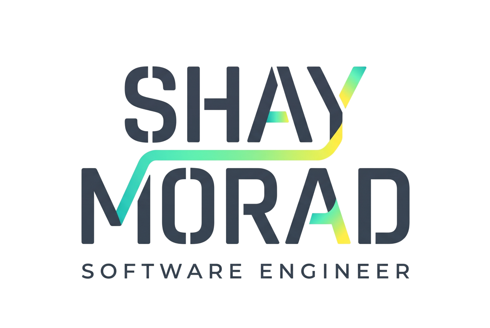

  

  <strong>B.Sc. Computer Science · The Hebrew University of Jerusalem</strong> 
  Software engineering · Backend · Systems · Computer vision · Machine learning

  
  
  

---

## About

I'm a Computer Science graduate of the Hebrew University of Jerusalem, interested in the engineering behind how software works: algorithms, performance, system design, and the details that make an implementation reliable.

My projects range from **stereo visual SLAM and computer vision** to **RDMA-based distributed communication, backend APIs, machine learning, and large-scale data analysis**. I like working close to the underlying problem, understanding the trade-offs, and building the important parts myself.

Before focusing on software engineering, I led technical intelligence projects involving complex data systems and cross-team coordination. I'm currently interested in software engineering roles, especially **backend, systems, infrastructure, and ML/CV engineering**.

## Selected projects

<table>
  <tr>
    <td width="50%" valign="top">
      <h3><a href="https://github.com/ShayMorad/3D-Computer-Vision-SLAM">3D Computer Vision SLAM</a></h3>
      Stereo visual odometry and SLAM, from feature tracking and geometric estimation to bundle adjustment, loop closure, and pose-graph optimization.  
      <b>Python · OpenCV · GTSAM · KITTI</b>
    </td>
    <td width="50%" valign="top">
      <h3><a href="https://github.com/ShayMorad/High-Performance-Networking-RDMA">High-Performance Networking & RDMA</a></h3>
      TCP and InfiniBand performance experiments, RDMA programming through libibverbs, and Ring All-Reduce with eager and rendezvous protocols.  
      <b>C · Linux · RDMA · InfiniBand Verbs</b>
    </td>
  </tr>
  <tr>
    <td width="50%" valign="top">
      <h3><a href="https://github.com/ShayMorad/LoL-Behavioral-Analysis">LoL Behavioral Analysis</a></h3>
      A data science workflow for analyzing player behavior and match dynamics across League of Legends data, from extraction and feature engineering to statistical analysis.  
      <b>Python · Pandas · Parquet · Data Science</b>
    </td>
    <td width="50%" valign="top">
      <h3><a href="https://github.com/ShayMorad/Image-Processing-Algorithms">Image Processing Algorithms</a></h3>
      Video analysis, Fourier and spectral methods, multiscale blending, stabilization, and panoramic mosaicing, with experimental results.  
      <b>Python · NumPy · OpenCV · Signal Processing</b>
    </td>
  </tr>
  <tr>
    <td width="50%" valign="top">
      <h3><a href="https://github.com/ShayMorad/Machine-Learning-Algorithms">Machine Learning Algorithms</a></h3>
      Implementations and evaluations of regression, classification, boosting, regularization, and numerical optimization methods.  
      <b>Python · NumPy · scikit-learn · Optimization</b>
    </td>
    <td width="50%" valign="top">
      <h3><a href="https://github.com/ShayMorad/Cyber-Security-Labs">Cyber Security Labs</a></h3>
      Low-level memory, network, and web security exercises exploring vulnerabilities and protocol behavior in controlled environments.  
      <b>C · Linux · Networking · Web Security</b>
    </td>
  </tr>
</table>

**More work:** [Computational Biology Algorithms](https://github.com/ShayMorad/Computational-Biology-Algorithms) · [Relational Database Systems](https://github.com/ShayMorad/Relational-Database-Systems) · [Operating Systems](https://github.com/ShayMorad/Operating-Systems) · [Nand2Tetris](https://github.com/ShayMorad/Nand2Tetris) · [C/C++ Programming Workshop](https://github.com/ShayMorad/Programming-Workshop-in-C-CPP)

## Languages & tools

### Languages & web

  
  
  
  
  
  
  
  
  

### Backend & databases

  
  
  
  
  
  
  
  

### Machine learning, data & computer vision

  
  
  
  
  
  
  

### Systems & development

  
  
  
  
  

**Specialized libraries & technologies**

  
  
  
  
  
  
  

**Also:** REST APIs · SQL · Docker Compose · TCP/IP · POSIX · GitHub

## Currently interested in

Building backend services and algorithm-heavy systems where performance, data, and correctness matter. Particularly interested in **software engineering, infrastructure, distributed systems, and applied ML/CV**.

## Contact

**[LinkedIn](https://www.linkedin.com/in/shay-morad/)** · **[Email](mailto:moradshay50@gmail.com)** · **[GitHub](https://github.com/ShayMorad)**
